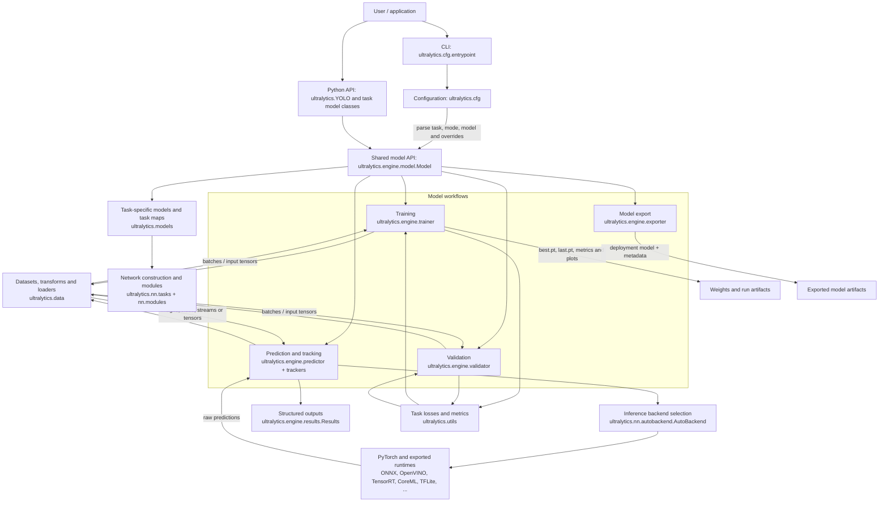

# Architecture Overview

Ultralytics is a Python computer-vision framework that exposes YOLO and related models through a shared Python API and `yolo` CLI. Its core pipeline connects task-specific models and data handling to reusable train, validation, prediction, tracking, and export workflows.

## Component diagram

## Runtime flow

- **Choose a task and mode:** The `yolo` entry point (`ultralytics.cfg.entrypoint`) parses task, mode, model and configuration overrides; the Python API offers the same workflow through model methods such as `train()`, `val()`, `predict()` and `export()`.
- **Dispatch to task implementations:** `ultralytics.engine.model.Model` uses its task map to select the relevant model, trainer, validator or predictor. `ultralytics.nn.tasks` builds neural networks from model YAML definitions and provides shared model/task behavior.
- **Load inputs and run work:** `ultralytics.data` supplies datasets, transforms, dataloaders and inference-source loaders. Training and validation consume dataset batches; prediction uses `BasePredictor` to preprocess inputs, run inference and package outputs as `Results` objects.
- **Deploy or continue training:** Prediction loads PyTorch or exported models through `AutoBackend`. Training writes checkpoints and metrics; `Exporter` converts PyTorch models to supported deployment formats and adds model metadata.

## Key package areas

| Path | Responsibility |
| --- | --- |
| `ultralytics/cfg/` | CLI entry point, task/mode selection, defaults and argument validation |
| `ultralytics/models/` | YOLO and other model families, including task-specific implementations |
| `ultralytics/engine/` | Shared model API, training, validation, prediction, results and export workflows |
| `ultralytics/nn/` | Model construction, neural-network modules and multi-format inference backends |
| `ultralytics/data/` | Dataset definitions, augmentation, loaders and dataloader construction |
| `ultralytics/utils/` | Shared configuration, checks, losses, metrics, callbacks and runtime utilities |
| `ultralytics/trackers/`, `ultralytics/solutions/` | Object tracking and higher-level computer-vision workflows |

## Extension points

Task model classes provide task maps that connect a task to its model, trainer, validator and predictor. Custom training, validation, prediction and export behavior can also be integrated through the callback hooks shared by these workflows.
